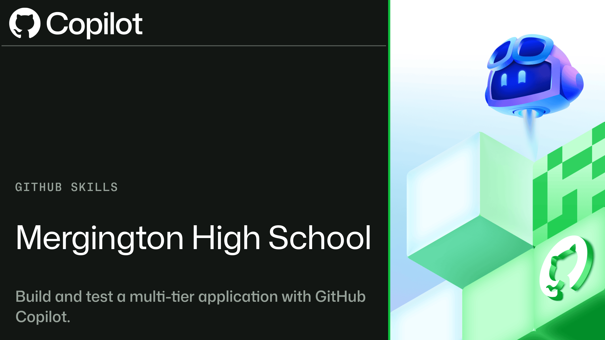

# Crie e teste uma aplicação multicamadas com o GitHub Copilot

_Use o modo Agent do GitHub Copilot para implementar, testar e revisar uma aplicação React + Express + MongoDB a partir de contratos executáveis._

## Welcome / Boas-vindas

- **Para quem é**: pessoas desenvolvedoras familiarizadas com GitHub, VS Code, JavaScript/TypeScript e os fluxos básicos do GitHub Copilot.
- **O que você aprenderá**: usar o modo Agent como parceiro de engenharia, respeitando os limites da arquitetura, orientando-se por testes, validando código gerado e revisando alterações multicamadas.
- **O que você criará**: o OctoFit Tracker, com registro de atividades, gerenciamento de equipes, placar competitivo e sugestões personalizadas de treino.
- **Pré-requisitos**:
  - [Introdução ao GitHub Copilot](https://github.com/skills/getting-started-with-github-copilot)
  - Familiaridade com React, APIs HTTP e testes automatizados.
  - Acesso ao [GitHub Codespaces](https://github.com/features/codespaces).
- **Duração**: 90 a 120 minutos, dependendo da sua familiaridade com o GitHub Copilot.

Neste exercício, você irá:

1. Explicar e preservar os limites entre apresentação, lógica e dados.
1. Usar testes com falha e contratos explícitos para delimitar o trabalho do Copilot.
1. Implementar e testar modelos Mongoose e dados de exemplo representativos.
1. Implementar e testar a API Express, incluindo validação e estados de erro.
1. Implementar e testar rotas React e interfaces alimentadas pela API.
1. Verificar o sistema integrado e revisar um pull request multicamadas antes do merge.

### Como iniciar este exercício

Copie o exercício para sua conta, aguarde **cerca de 20 segundos** para que Mona prepare a primeira lição e **atualize a página**. O botão exige que este repositório esteja habilitado como template no GitHub.

Having trouble? 🤷 Precisa de ajuda?
 

- Escolha sua conta pessoal ou uma organização como proprietária da cópia.
- Recomendamos um repositório público; repositórios privados consomem minutos do Actions.
- Se o exercício não estiver pronto após 20 segundos, abra a aba **Actions** da cópia.
- Se um job falhar, execute-o novamente uma vez. Se a falha persistir, abra uma issue com o link do log.

### Glossário

- **Agent**: modo que pode inspecionar e alterar o projeto e executar comandos com sua supervisão.
- **Agent picker**: seletor de agentes no chat do Copilot; selecione **Agent** para este exercício.
- **Permission levels / aprovações**: controles que determinam quais ações exigem sua autorização. Revise as solicitações antes de aprová-las.
- **Contrato**: comportamento esperado descrito em documentação ou testes executáveis.

Consulte a [documentação do modo Agent](https://docs.github.com/pt/copilot/how-tos/copilot-in-your-ide/use-copilot-agents/use-agent-mode) e as [instruções para usar agentes no VS Code](https://code.visualstudio.com/docs/chat/chat-overview#_builtin-chat-modes).

---

&copy; 2025 GitHub &bull; [Código de Conduta](https://www.contributor-covenant.org/version/2/1/code_of_conduct/code_of_conduct.md) &bull; [Licença MIT](https://gh.io/mit)
