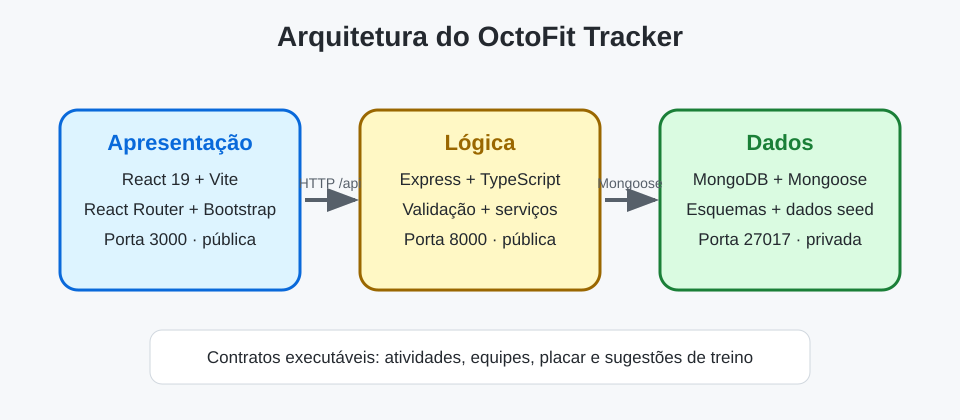

# Arquitetura do OctoFit Tracker

O OctoFit Tracker é uma aplicação de três camadas para um programa de fitness escolar. O código inicial inclui contratos de API e pontos de implementação propositalmente incompletos para que você use o modo Agent do GitHub Copilot em um ciclo orientado por testes.

## Limites das camadas

- **Presentation tier — apresentação**: React 19, Vite, React Router, Bootstrap e um cliente de API compartilhado em `octofit-tracker/frontend/src`.
- **Logic tier — lógica**: rotas e serviços Express e TypeScript em `octofit-tracker/backend/src` expõem `/api/*` na porta `8000`.
- **Data tier — dados**: modelos Mongoose e dados iniciais em `octofit-tracker/backend/src/models` e `src/scripts/seed.ts` são persistidos no MongoDB na porta `27017`.

## Portas e regras do ambiente

- MongoDB: `27017`
- API Express: `8000`
- Frontend Vite: `5173`
- O navegador usa caminhos relativos `/api`. O Vite os encaminha para `http://localhost:8000`, mantendo privada no Codespaces a porta da API sem autenticação. `VITE_API_BASE_URL` pode substituir a URL base.

## Contrato da API

| Funcionalidade | Método e caminho | Comportamento esperado |
| --- | --- | --- |
| Activity tracking — atividades | `GET /api/activities`, `POST /api/activities` | Listar e criar atividades válidas. POST aceita `userId`, `teamId`, `type` e `minutes`; `userId` e `teamId` devem ser IDs bem formados de um usuário e uma equipe existentes; caso contrário, responder com 4xx deliberado, nunca 500 por erro de conversão. A atividade criada armazena `user`, `team`, `type` e `minutes` enviados, além de `points` e `occurredAt` calculados. |
| Teams — equipes | `GET /api/teams`, `POST /api/teams` | Listar e criar equipes com membros. Equipes criadas e listadas mantêm `name` e `mascot` enviados. Rejeitar equipe sem nome com `400`. |
| Leaderboard — placar | `GET /api/leaderboard` | Retornar equipes ordenadas pela soma de pontos das atividades, da maior para a menor. Cada entrada tem `teamName`, `totalPoints` e `rank` iniciado em 1. |
| Workout suggestions — sugestões de treino | `GET /api/workouts/suggestions/:userEmail` | Recomendar treinos a partir das atividades recentes do usuário inicial correspondente ao email. O `focus` da primeira sugestão corresponde ao objetivo ou à atividade recente e `reason` explica o motivo. Um email sem usuário correspondente retorna 4xx deliberado, por exemplo `404`. |

## Decisões de implementação

Registre seu plano após cada rótulo antes de editar o código. Preserve os rótulos em inglês, pois são usados na avaliação.

- Presentation tier decision:
- Logic tier decision:
- Data tier decision:
- Activity tracking approach:
- Team management approach:
- Leaderboard approach:
- Workout suggestions approach:

## Plano de testes

Registre os comandos executados e o significado de cada falha.

- Teste da camada de dados: `npm run test:data --prefix octofit-tracker/backend`
- Teste da API: `npm run test:api --prefix octofit-tracker/backend`
- Teste do frontend: `npm test --prefix octofit-tracker/frontend`
- Build do backend: `npm run build --prefix octofit-tracker/backend`
- Build do frontend: `npm run build --prefix octofit-tracker/frontend`
